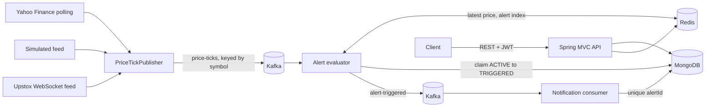

# NSE Stock Price Alert System

An event-driven backend that lets users set price alerts on NSE-listed stocks and notifies them when a target is crossed. Built with Spring Boot, Kafka, Redis and MongoDB.

Prices come from one of three feeds, set by `FEED_SOURCE`:

- `yahoo` (default): real NSE prices polled every 30 seconds from Yahoo Finance's chart endpoint, with no account or key. It's **unofficial**, so it may change or block requests without notice, prices may be delayed, and moves between polls can be missed. It suits personal use and demos, not a commercial product.
- `simulated`: random prices that keep moving when the market is closed, useful for demos. **These are not real market prices.**
- `upstox`: live NSE prices from the [Upstox Market Data Feed V3](https://upstox.com/developer/api-documentation/get-market-data-feed/), which needs an Upstox account and access token.

Every price response includes its `source`, so they can't be confused. This project is not investment advice.

## How it works



## Design decisions

| Problem | Approach |
|---|---|
| Checking every tick against every alert is too slow | Redis sorted sets per symbol and direction, scored by target price. A tick costs O(log n + matches) |
| Floating-point errors in money | Prices are whole paise (`long`), which are also exact as Redis scores |
| An alert firing twice | MongoDB `findAndModify` moves it from `ACTIVE` to `TRIGGERED`, and only one caller can win |
| A crash between saving and publishing | The alert records `eventPublished`, and a sweeper republishes anything unacknowledged (outbox pattern) |
| Duplicate Kafka delivery | A unique index on `alertId` makes the notification insert idempotent |
| Malformed messages blocking a partition | Non-retryable errors go straight to a `.DLT` topic; others get 3 retries first |
| Ticks per stock arriving out of order | Kafka keys by symbol, and a Lua script stops an old tick overwriting a newer price |
| Redis losing its data | MongoDB is the source of truth, and the index is rebuilt on startup |
| Live feed connection dropping | Reconnects with exponential backoff, getting a new single-use feed URL and resubscribing each time |
| Connection dying silently | If no data arrives for 60 seconds during market hours, the feed reconnects |
| Upstox's daily token expiry | A rejected token stops retries, logs what to do and turns `/actuator/health` DOWN |
| Simulated prices hiding real ones | Latest prices are stored per feed source, because simulated timestamps would look newer than the last real trade |
| Old ticks after switching feeds | Each tick carries its source, and the evaluator ignores any not from the current feed |
| Yahoo rate limits or outages | A failed round stops at once and backs off exponentially, up to 15 minutes, and turns `/actuator/health` DOWN |
| Polling more than necessary | Identical prices aren't republished, and polling drops to every 10 minutes while the market is closed |
| Covering all of NSE when Yahoo is asked one stock at a time | All equities can be searched, but only stocks in use are polled: those with active alerts, then the default watchlist |
| Too many stocks in use | Above 50 stocks per round, rounds rotate so each still gets a turn, more slowly |
| Charts asking Yahoo for the same history repeatedly | History is cached in Redis (5 minutes intraday, longer for daily data) and shares the feed's backoff and request budget. If Yahoo fails, a saved copy is shown and marked as such |
| Moving averages missing at the start of a chart | Each range fetches more history than it shows, so indicators have values from the first visible point |
| Scoring a stock honestly | A 0 to 100 score from 13 parameters across 6 categories, with every value and rule shown. Missing data is excluded rather than counted as low, and with too little data no score is given. "Confidence" measures how complete and recent the data is, not the likelihood of a price rise |
| Lenders' debt figures misleading the score | Yahoo's data has no sector, so lenders and insurers are recognised by name and their debt and cash-flow parameters are skipped |
| Viewing stocks outside the polled set | A stock is fetched when viewed, at most once per poll interval and within a budget of 30 such requests a minute |

**Delivery guarantee:** Kafka delivery is at-least-once and the consumer is idempotent, so each alert produces one notification.

**Known limitation:** the sweeper and notifications cover failures after an alert is claimed. An alert only fires on ticks that reach the evaluator, and if a stock crosses a target and returns between ticks, the alert does not fire.

## Indian market details

- With the Yahoo feed, you can search about 3,500 NSE equities, including SME stocks, and set alerts on any of them. The list is refreshed daily from [Upstox's public instrument file](https://upstox.com/developer/api-documentation/instruments/), which needs no account. Bonds and other debt are left out.
- The simulated and Upstox feeds only cover the 10 stocks configured in `application.yml`.
- Instruments are NSE symbols with their ISINs, and prices are in rupees held as whole paise.
- `MarketHours` models the normal session: Monday to Friday, 09:15 to 15:30 IST.
- Set `app.market.holidays` from the official NSE circular. It ships empty, and special sessions such as Muhurat trading are not modelled.
- For the simulator, `FEED_RESPECT_MARKET_HOURS` defaults to `false` so demos run at any time. Set it to `true` to produce ticks only during market hours.

## Run it

Requires Java 17 and Docker.

Start Kafka, Redis and MongoDB, then the app:

```bash
docker compose up -d
```

```bash
./mvnw spring-boot:run
```

On Windows use `.\mvnw.cmd spring-boot:run`. To run the app in Docker as well, use `docker compose --profile app up -d --build`.

API docs are at http://localhost:8080/swagger-ui.html. If port 8080 is taken, set `APP_PORT` for Docker, or pass `--server.port` when running locally. Redis and MongoDB are published on ports 6390 and 27027 so they can't clash with other local projects.

Set `JWT_SECRET` (32+ bytes) to keep tokens valid across restarts. Without it, the app generates a random key on each start.

Real prices barely move outside market hours, so alerts rarely fire then. To demo alerts at any time, set `FEED_SOURCE=simulated`.

### Optional: use live Upstox prices

This needs an Upstox account, which involves KYC. The default Yahoo feed doesn't.

1. Create an app in the [Upstox developer console](https://account.upstox.com/developer/apps) and generate an access token.
2. Copy `.env.example` to `.env` and paste in the token. Git ignores `.env`; never commit a real token.
3. If you've already run with simulated prices, start clean, so leftover simulated ticks and alerts can't be processed as real: `docker compose --profile app down -v`, then `docker compose up -d`.
4. Start the app. `GET /api/market/prices/{symbol}` should now return `"source": "upstox"`.

Upstox tokens expire daily at 3:30 AM, so each new day needs a new token and a restart. Check Upstox's terms before showing its data to other people.

## Frontend

The `frontend` folder has NSE AlertPulse, a React dashboard for this API. To preview it with sample data and no backend:

```bash
cd frontend
```

```bash
npm install
```

```bash
npm run dev:mock
```

Then open http://localhost:5173. See [frontend/README.md](frontend/README.md) to run it against the backend.

## API

| Method | Path | Purpose |
|---|---|---|
| POST | `/api/auth/register` | Create an account and get a token |
| POST | `/api/auth/login` | Get a token |
| GET | `/api/market/status` | Whether NSE is open now |
| GET | `/api/market/instruments` | The default watchlist |
| GET | `/api/market/instruments/search?q=wipro` | Search stocks by symbol, company name or ISIN |
| GET | `/api/market/prices/{symbol}` | Latest price and its source |
| GET | `/api/market/history/{symbol}?range=6M` | Price history with 20 and 50-period moving averages and 14-period RSI. Ranges: 1D, 1W, 1M, 6M, 1Y, 5Y. Yahoo feed only |
| GET | `/api/market/scorecard/{symbol}` | Rule-based score across profitability, growth, financial health, valuation, price trend and risk. Yahoo feed only. Not a prediction or recommendation |
| POST | `/api/alerts` | Create an alert: `{"symbol":"TCS","direction":"ABOVE","targetPrice":3600.00}` |
| GET | `/api/alerts` | List your alerts, paged. Filter with `?status=ACTIVE`; repeat `status` for several |
| DELETE | `/api/alerts/{id}` | Cancel an active alert |
| GET | `/api/notifications` | List your notifications, paged |

## CI/CD

[GitHub Actions](.github/workflows/ci.yml) runs on every pull request and every push to `main`:

1. **Backend tests:** the full Maven build, with integration tests against real Kafka, Redis and MongoDB.
2. **Frontend tests:** a clean install, unit tests, type-check and production build.
3. **Docker images:** built only if both test jobs pass. Pull requests stop here, which proves the images build.
4. **Publish:** pushes to `main` publish the `app` and `web` images to GitHub Container Registry, tagged `latest` and with the short commit ID.

Dependabot proposes dependency updates monthly. Deploying to a server isn't included, because that depends on where the app is hosted.

Tests use MongoDB 8.2, because MongoDB 8.0 refuses to start on Linux kernels from 6.19 up to 7.0.13 ([SERVER-121912](https://jira.mongodb.org/browse/SERVER-121912)), which includes GitHub's current runners. `docker-compose.yml` still uses 8.0, so on an affected machine change its image to `mongo:8.2`. That upgrades any existing data in place, so back it up first.

To run the full system from containers, with the dashboard at http://localhost:8088:

```bash
docker compose --profile app up -d --build
```

## Tests

```bash
./mvnw verify
```

Integration tests use Testcontainers to run real Kafka, Redis and MongoDB, and **are skipped if Docker is not running**. They cover duplicate ticks and events, dead-lettering, rebuilding the index, cancellation, access between users and validation.

The Yahoo and Upstox clients are tested against local fake servers, covering price parsing, rate limits and backoff, reconnects and token rejection.
